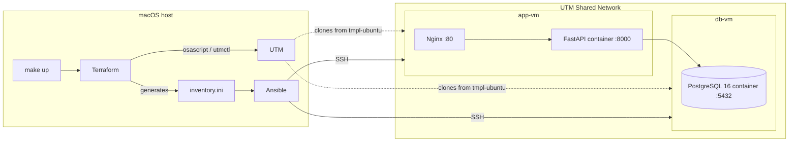

# One-Click Infrastructure: Terraform + Ansible on Local VMs

> `make up` builds a two-VM environment from scratch on macOS (UTM): Terraform provisions the VMs, Ansible configures them, and a FastAPI app goes live behind Nginx with a PostgreSQL backend.


The goal is to show the full DevOps loop on a laptop, without a cloud bill: **IaC → configuration management → containerized deploy → reverse proxy → verification**, all triggered by one command.

---

## Contents

- [Architecture](#architecture)
- [How It Works](#how-it-works)
- [Prerequisites](#prerequisites)
- [Quick Start](#quick-start)
- [Step-by-Step](#step-by-step)
- [Project Structure](#project-structure)
- [Notes & Roadmap](#notes--roadmap)

---

## Architecture



## How It Works

| Layer | Tool | Responsibility |
|-------|------|----------------|
| Provisioning | **Terraform** (`external`, `local`, `null` providers) | Clones and starts `app-vm` and `db-vm` from a UTM template, reads their IPs via the QEMU guest agent, generates the Ansible inventory, destroys VMs on `terraform destroy` |
| Configuration | **Ansible** roles | `docker` — installs Docker · `db` — runs PostgreSQL · `app` — builds and runs the API image · `nginx` — reverse proxy |
| Application | **FastAPI** in Docker | `GET /health` → `{"status":"ok"}`, `GET /health/db` → `{"db":"ok"}` (checks the DB connection) |
| Edge | **Nginx** | Proxies `:80` → `127.0.0.1:8000` (the API is not exposed directly) |

## Prerequisites

> macOS only — the project drives the [UTM](https://mac.getutm.app/) hypervisor.

```bash
brew install terraform ansible make
brew install --cask utm
```

A UTM template VM named **`tmpl-ubuntu`** (Debian 12 ARM64 works) with:

- the OS installed and the ISO ejected (CD/DVD → *Empty*), so it boots from disk
- SSH access for user `debian`
- **QEMU Guest Agent** — Terraform gets the VM IPs through it:

  ```bash
  sudo apt update && sudo apt install -y qemu-guest-agent
  sudo systemctl enable --now qemu-guest-agent
  ```

- network mode **Shared Network**, so the host and both VMs can reach each other

## Quick Start

```bash
make up        # terraform apply → ansible-playbook → curl /health
make destroy   # removes both VMs (even if Terraform state is gone)
```

If the first run fails, it is almost always the template: missing guest agent or the installer ISO still attached.

## Step-by-Step

**1. Provision VMs**

```bash
cd terraform && terraform init && terraform apply -auto-approve
terraform output -raw app_ip
terraform output -raw db_ip
```

**2. Configure them**

```bash
ansible-galaxy collection install community.docker
ANSIBLE_HOST_KEY_CHECKING=False ansible-playbook -i ansible/inventory.ini ansible/playbook.yml
```

**3. Verify**

```bash
APP_IP=$(cd terraform && terraform output -raw app_ip)
curl -i http://$APP_IP/health
curl -i http://$APP_IP/health/db

DB_IP=$(cd terraform && terraform output -raw db_ip)
ssh debian@$DB_IP "docker ps | grep postgres"
```

## Project Structure

```text
.
├── Makefile                     # up / destroy
├── terraform/
│   └── main.tf                  # VM lifecycle, inventory generation, outputs
├── scripts/
│   ├── utm_ensure_vms.sh        # clone/start VMs, return IPs as JSON
│   └── utm_destroy_vms.sh       # stop and delete VMs
├── ansible/
│   ├── playbook.yml
│   └── roles/{docker,db,app,nginx}/
└── app/
    ├── Dockerfile
    ├── main.py                  # FastAPI health endpoints
    └── requirements.txt
```

`ansible/inventory.ini`, Terraform state and provider binaries are generated locally and git-ignored.

## Notes & Roadmap

Credentials in the roles are lab defaults for an isolated local network. Next steps:

- [ ] Move DB credentials to `ansible-vault`
- [ ] Bind PostgreSQL to the private network only and add a firewall
- [ ] Add a GitHub Actions workflow with `terraform fmt/validate` and `ansible-lint`
- [ ] Add Prometheus node exporters to both VMs

---

## Related Projects

- [aws-infrastructure-terraform](https://github.com/spaceman5789/aws-infrastructure-terraform) — the same 2-tier idea on real AWS
- [ansible-server-automation](https://github.com/spaceman5789/ansible-server-automation) — single-host Nginx + Docker + HTTPS playbook

## Author

**Denis Nazarov** — DevOps Engineer · [GitHub](https://github.com/spaceman5789) · [Portfolio](https://denzo-portfolio.site)
